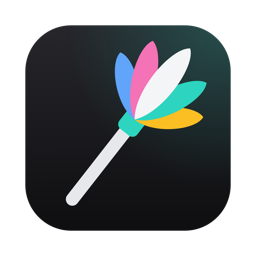

<p align="center">
  
</p>

<h1 align="center">MacDuster</h1>

<p align="center">
  A feather duster for your Mac: cleanup, uninstaller, large-file finder and a live status panel in the menu bar.<br>
  Built with SwiftUI, no dependencies and no Xcode required.
</p>

---

## Features

### App

| Module | What it does |
|---|---|
| **Cleanup** | Scans user caches, logs, Xcode leftovers, developer caches, Mail attachments, iOS backups and the Trash. Shows how much each category takes up and lets you choose what to remove. |
| **Uninstaller** | Lists installed apps and removes their leftovers too (preferences, caches, support data). |
| **Large files** | Finds the heaviest files, with filters by size and time since last use, and reveals them in Finder. |
| **Performance** | Top memory-consuming processes, login items and maintenance tasks: free up RAM, flush the DNS cache, reindex Spotlight, rebuild Launch Services, restart Quick Look, thin Time Machine snapshots and restart Finder and Dock. |

### Menu bar panel

Click the feather duster icon to open a panel with live data:

- **Disk**: free and used space, plus the Trash size with a shortcut to empty it.
- **Memory** and **processor**: usage percentage and CPU temperature (Intel Macs).
- **Network**: real-time upload and download speed, plus the Wi-Fi name and link speed.
- **Battery**: level and charging state.
- **Speed test**: measures download, upload and responsiveness using macOS's `networkQuality` tool.
- **Alerts** when disk space is low or the Trash is very full, with optional notifications.
- Setting to launch the app at login.

The panel only samples while it is open, so it uses no resources in the background.

### Safety

- A safety guard prevents deleting system paths, the home directory or `/Applications`.
- Anything that isn't permanent is moved to the Trash instead of being deleted.
- Tasks that need elevated privileges ask for the administrator password through macOS.

## Requirements

- macOS 12 or later
- To build from source: Xcode command line tools (`xcode-select --install`)

To remove some items (for example, other apps' caches) you may need to grant MacDuster **Full Disk Access** in *System Settings → Privacy & Security*.

## Download

Grab the latest universal build (Intel and Apple Silicon) from the [Releases page](https://github.com/null-result/macduster/releases/latest), unzip it and drag `MacDuster.app` to `/Applications`.

The app is ad-hoc signed and not notarized, so macOS will warn you the first time. Right-click the app and choose **Open**, or run:

```sh
xattr -dr com.apple.quarantine /Applications/MacDuster.app
```

## Build from source

```sh
git clone https://github.com/null-result/macduster.git
cd macduster
zsh Scripts/build_app.sh
open build/MacDuster.app
```

The script compiles with `swiftc` (no Xcode or SwiftPM needed), builds a universal binary (Intel + Apple Silicon), packages `build/MacDuster.app` and signs it with an ad-hoc signature. To install it, copy the `.app` to `/Applications`.

### Tests

The package is also SwiftPM-compatible (with Xcode installed):

```sh
swift test
```

## Project layout

```
Sources/
  MacDusterCore/   UI-free logic: scanning, safe deletion, system stats,
                   temperature (SMC), speed test, maintenance
  MacDuster/       SwiftUI interface and menu bar panel
Scripts/
  build_app.sh     Builds and packages the app
  make_icon.swift  Draws the vector icon and generates the .icns
Tests/             Core layer tests
```

## Design

Neutral graphite background, translucent surfaces with hairline borders and a single accent color per module (teal, pink, blue and amber). The icon is generated in code from `Scripts/make_icon.swift`:

```sh
swift Scripts/make_icon.swift
iconutil -c icns build/AppIcon.iconset -o Resources/AppIcon.icns
```

## Notes

- CPU temperature is read from the SMC, so it is available on Intel Macs; on Apple Silicon the card shows usage only.
- The Wi-Fi network name may not appear if macOS doesn't grant location permission.
- The interface is currently in Spanish.

## License

[MIT](LICENSE)
